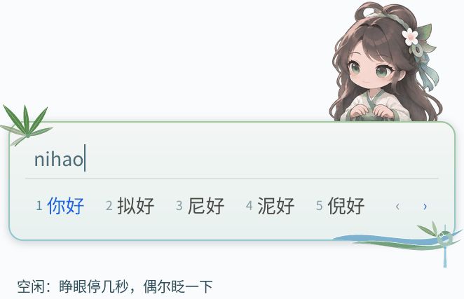
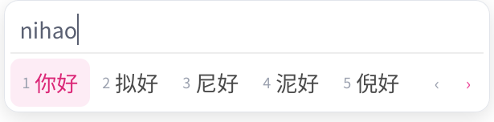
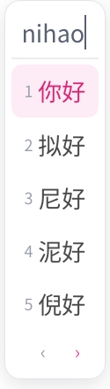
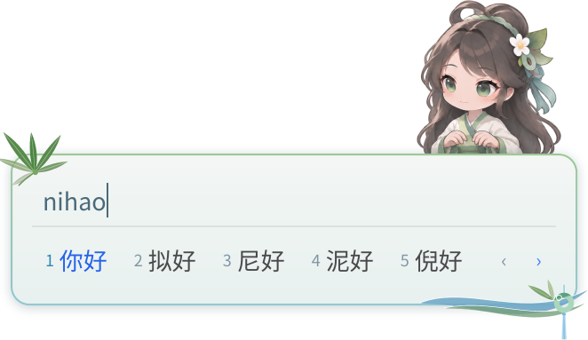
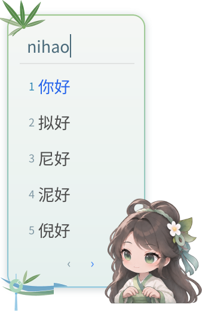

# 清风输入法主题示例

[清风输入法（WindInput）](https://github.com/huanfeng/WindInput)主题的示例与模板仓库：三个由浅入深的示例主题、
把动作精灵图合成动画的脚本，以及一套**用 AI 生成同类主题**的提示词模板，静态的、动态的都有。

## 效果

动态版「清风娘·动态版」随输入事件切换动作（下图是演示动画，完整的 9 个动作见[动作一览](docs/images/states.png)）：



三个示例主题（输入法里的实际渲染，横排 / 竖排）：

| 主题 | 横排 | 竖排 |
|---|---|---|
| `01-color` 樱粉（换色） |  |  |
| `02-skin-static` 清风娘·静态版 |  |  |
| `03-skin-animated` 清风娘·动态版 |  |  |

> 截图由输入法的渲染引擎在 Linux 上离屏渲染（动态版取首帧）；实际显示以各平台为准。

## 目录

| 目录 | 内容 |
|---|---|
| [`themes/01-color`](themes/01-color) | 换色主题：10 行，继承内置基础主题，只改主色 |
| [`themes/02-skin-static`](themes/02-skin-static) | 静态皮肤：异形窗体＋不动的人物装饰，注释最全 |
| [`themes/03-skin-animated`](themes/03-skin-animated) | 动态皮肤「清风娘·动态版」：人物随打字、上屏、点击等事件切换动作 |
| [`sources/qingfeng-niang`](sources/qingfeng-niang) | 动态版的**源码**：10 张 2×2 精灵图原稿＋合成配置 |
| [`prompts`](prompts) | AI 提示词模板：角色设计、窗体框架、动作精灵图、静态装饰、配色、让 AI 写配置 |
| [`tools`](tools) | `sprites_to_apng.py` 精灵图→动画；`check_theme.py` 检查；`pack_wtheme.py` 打包 |
| [`docs/workflow.md`](docs/workflow.md) | 从设计到发布的完整流程 |

## 三分钟上手

```sh
pip install -r tools/requirements.txt

# 1. 把示例主题复制到输入法的用户主题目录，在设置里选「清风娘·静态版」
#    Windows：%APPDATA%\WindInput\themes\

# 2. 重新合成动态版的动画（结果与 themes/03-skin-animated/assets/actions.png 逐字节一致）
python tools/sprites_to_apng.py sources/qingfeng-niang/sprites.toml -o /tmp/actions.png

# 3. 检查并打包
python tools/check_theme.py themes/03-skin-animated
python tools/pack_wtheme.py themes/03-skin-animated -o dist/qingfeng-niang-animated.wtheme
```

## 想做自己的主题

从 [`prompts/README.md`](prompts/README.md) 开始：按想做的类型（换色 / 静态皮肤 / 动态皮肤）选模板，
用 AI 生成素材与配置，再用本仓的脚本合成、检查、打包。

## 要求

- 主题格式：皮肤主题需要清风输入法 0.131 及以上；`click` 的 `alt` / `lock` 需要 0.133 及以上（旧版本忽略，其余照常）。
- 脚本：Python 3.11+，Pillow。

## 许可

[MIT](LICENSE)：脚本、文档、提示词模板与示例主题（含素材）均适用。
